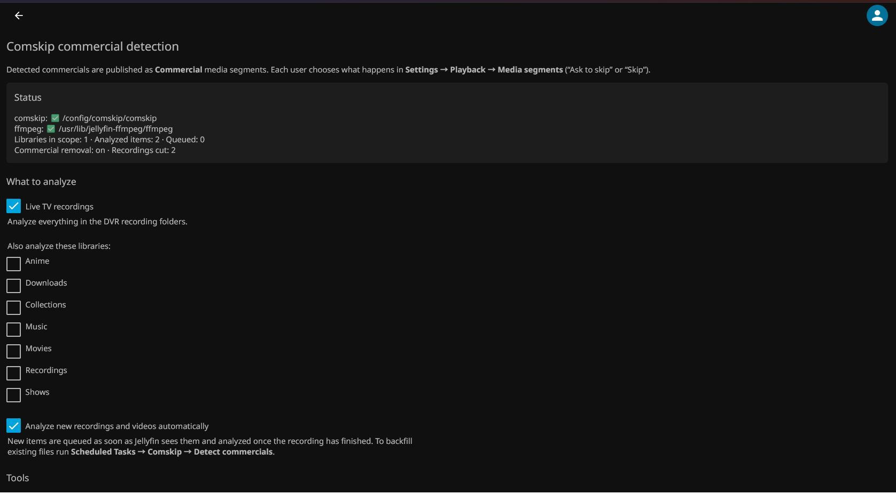
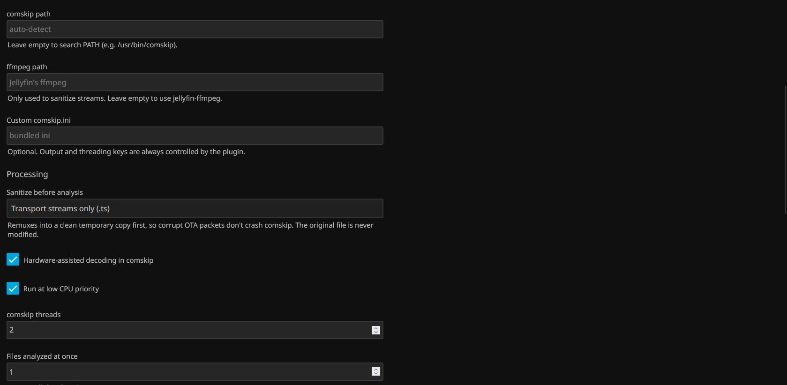
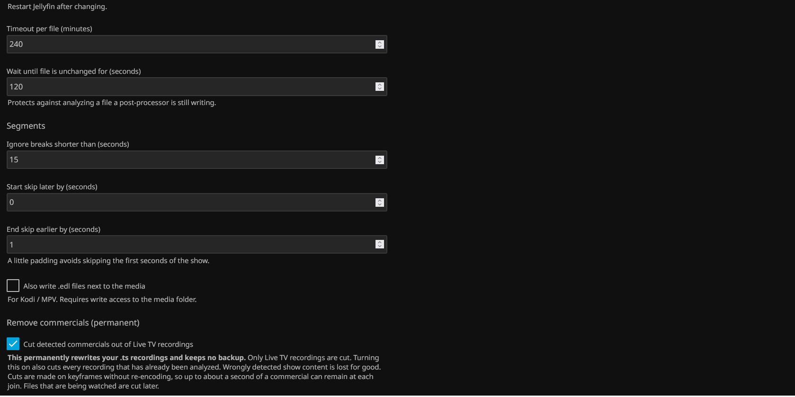
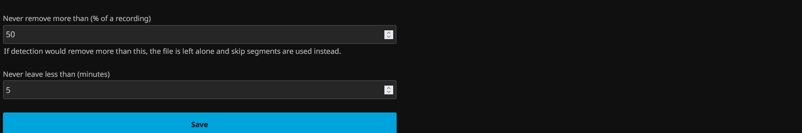

# Jellyfin Comskip Plugin

A Jellyfin 12.x plugin that runs [comskip](https://github.com/erikkaashoek/Comskip) on your DVR recordings (and any other library you choose) and publishes the commercial breaks as **Commercial media segments**. Jellyfin clients then show a **Skip** button, or skip on their own, the same way Intro Skipper handles intros.

> [!IMPORTANT]
> **Each user must turn on commercial skipping, or this plugin does nothing visible.**
> Jellyfin ignores Commercial segments by default. Every user who wants to skip commercials has to open
> **Settings → Playback → Media segments → Commercial** and set it to **Ask to skip** (shows a Skip button)
> or **Skip** (jumps past the break automatically). It is a per-user setting, so each user, on each profile, must change it.

> [!NOTE]
> **By default your recordings are never changed.** The `.ts` file stays exactly as it was, with no remux to MKV, no chapters added and nothing deleted.
> The commercial times are stored by the plugin and handed to Jellyfin as segments. See [How it works](#how-it-works) for how to confirm a recording was analyzed.
> Version 2.0 adds an **optional** setting that permanently cuts the commercials out instead; see [Removing commercials](#removing-commercials-optional-20).

> [!CAUTION]
> **The "Cut detected commercials" option modifies your original recording files in a way that CANNOT be recovered.**
> When it is checked, each Live TV `.ts` recording is overwritten with a copy that has the commercials removed. The original file is **not backed up, not moved to a recycle bin and not kept anywhere**, so there is **no way to undo it**, by this plugin, by Jellyfin or by unchecking the option.
> Anything comskip wrongly marks as a commercial is **lost forever**. Checking the box also applies this to **every recording already analyzed**, immediately. If you are not willing to lose content, leave this option off. The default skip segments never touch your files.

It grew out of [Jellyfin-Comskip-Post-Processor](https://github.com/williamthrilliam/Jellyfin-Comskip-Post-Processor) and keeps that script's robustness tricks. It does not rewrite your files, though:

| Post-processor script | This plugin |
|---|---|
| Configured as the Live TV post-processor | Installed from a plugin repository; analysis starts on its own when a recording finishes |
| Remuxes `.ts` to `.mkv`, injects chapters, deletes the original | By default **never modifies media files**: results are stored by the plugin and served as segments. Optionally (2.0) cuts the commercials out of the `.ts` in place |
| Needs the Chapter Segments Provider plugin | Is its own segment provider |
| `batch-comskip.sh` for an existing library | **Scheduled Tasks → Comskip → Detect commercials** |
| Sanitizing remux so corrupt OTA streams don't crash comskip | Same, into a temporary file in Jellyfin's cache (setting: *Sanitize before analysis*) |
| Auto-generates `comskip.ini` | Ships a tuned ini (from the original repo); you can point to your own |

## Requirements

- **Jellyfin 12.x only.** Plugins built for 10.11 do not load on 12.x, and this one does not load on 10.11 or earlier.
- **Platform:** the ready-made comskip download (below) is for **Linux only**, on **x64** and **ARM64** (e.g. Raspberry Pi), including the official Docker image. On **Windows** or **macOS** you must install comskip yourself and enter its path in the plugin settings (**comskip path**). Commercial removal also needs ffmpeg and ffprobe, which come with Jellyfin.
- **comskip installed on the Jellyfin server**, either on `PATH` or at a path you enter in the settings:
  - Ubuntu/Debian bare metal: `sudo apt install comskip`
  - **Docker (official `jellyfin/jellyfin` image, unmodified):** copy the self-contained comskip build from this repo's [`comskip-static` release](https://github.com/zenmaster14/jellyfin-plugin-comskip/releases/tag/comskip-static) into your config volume. It is statically linked, so it needs nothing from the image, and because it lives in `/config` it survives image updates. The plugin finds `/config/comskip/comskip` on its own.
    ```bash
    docker exec -u root jellyfin sh -c 'mkdir -p /config/comskip && curl -fL -o /config/comskip/comskip https://github.com/zenmaster14/jellyfin-plugin-comskip/releases/download/comskip-static/comskip-linux-x64 && chmod 755 /config/comskip/comskip'
    ```
    Replace `jellyfin` with your container's name, and use `comskip-linux-arm64` on ARM (e.g. Raspberry Pi). The build recipe is [`tools/build-static-comskip.sh`](tools/build-static-comskip.sh).
- ffmpeg is optional. By default the plugin uses Jellyfin's own `jellyfin-ffmpeg` for the sanitizing remux.

## Install

### From a plugin repository (recommended)

1. In Jellyfin, go to **Dashboard → Plugins → Repositories → +** and add:
   - **Name:** `Comskip`
   - **URL:** `https://raw.githubusercontent.com/zenmaster14/jellyfin-plugin-comskip/main/manifest.json`
2. Under **Catalog**, install **Comskip**, then restart Jellyfin.

### Publishing a new version

Set `version:` in `build.yaml` (e.g. `1.0.1.0`) and push to `main`. The **Release** workflow builds the DLL, publishes `comskip_<version>.zip` as a [GitHub release](https://github.com/zenmaster14/jellyfin-plugin-comskip/releases), and adds the version to `manifest.json`, so Jellyfin offers it as an update. You can also start the workflow by hand from the repo's **Actions** tab.

### Manually

```bash
dotnet publish Jellyfin.Plugin.Comskip/Jellyfin.Plugin.Comskip.csproj -c Release -o out
mkdir -p /var/lib/jellyfin/plugins/Comskip_1.0.0.0
cp out/Jellyfin.Plugin.Comskip.dll /var/lib/jellyfin/plugins/Comskip_1.0.0.0/
sudo chown -R jellyfin:jellyfin /var/lib/jellyfin/plugins/Comskip_1.0.0.0
sudo systemctl restart jellyfin
```
In Docker the plugin folder is `/config/plugins`. Building needs the .NET 10 SDK.

## Set up

1. Open **Dashboard → Plugins → Comskip**. The status box at the top shows whether comskip and ffmpeg were found.
2. Choose what to analyze. **Live TV recordings** is on by default; tick any other libraries you want.
3. If you used the old script, clear **Dashboard → Live TV → Recording post-processing**. The plugin replaces it, and remuxing to MKV is no longer required.
4. **Required, for every user:** open **Settings → Playback → Media segments → Commercial** and choose **Ask to skip** or **Skip**. The default ignores commercials, and then no Skip button ever appears, even though the plugin has found the breaks.
5. To backfill recordings you already have, run **Dashboard → Scheduled Tasks → Comskip → Detect commercials (Comskip)**. It also runs nightly at 03:00 to catch anything missed.
6. In each library's settings, make sure the **Comskip** media segment provider is enabled. It is enabled by default.
7. **Optional and irreversible:** only check **Cut detected commercials out of Live TV recordings** if you accept that your original recordings will be permanently modified and **cannot be recovered**. See [Removing commercials](#removing-commercials-optional-20).

## Screenshots

The plugin's settings page in Jellyfin 12 (**Dashboard → Plugins → Comskip**):

**Status and what to analyze.** The status box confirms that comskip and ffmpeg were found and shows progress.



**Tools and processing**



**Segment shaping and the optional commercial removal.** See the [irreversibility warning](#removing-commercials-optional-20) before checking *Cut detected commercials*.





## How it works

- **Library watcher:** when Jellyfin adds or updates a video in scope, the item is queued. Items are only analyzed once the recording is no longer in progress and the file hasn't changed for *Settle seconds* (120 by default). Busy files are retried every 5 minutes for up to 24 hours.
- **Analysis:** comskip runs in its own folder under Jellyfin's cache directory (`<cache>/comskip/<itemId>`), with EDL output forced on, and the folder is deleted afterwards. `.ts` files are first stream-copied into a clean temporary transport stream: corrupt packets are dropped, timestamps regenerated and data/SCTE-35 streams removed.
- **Storage:** one JSON file per item in `<config>/plugins/configurations/Comskip/results/`. A result stays valid while the file's size and modification time are unchanged.
- **Cleanup:** a result file is deleted automatically as soon as Jellyfin removes the item from its library. That covers deleting the recording in Jellyfin, Live TV's "keep up to" limit, and `.ts` files deleted outside Jellyfin once a library scan or the folder monitor notices them missing. As a safety net, the nightly task also deletes any result whose item no longer exists, for example if a recording disappeared while Jellyfin was stopped.
- **Segments:** after each run the plugin asks Jellyfin to refresh that item's media segments. Breaks are merged, padded (by default 1 s is trimmed off the end of each break so you don't miss the show's first second) and filtered (breaks under 15 s are dropped).
- **Optional `.edl` sidecars** for Kodi and MPV (off by default).

### Checking that a recording was analyzed

- **Dashboard → Plugins → Comskip:** *Analyzed items* goes up and the recording appears under *Recent activity*.
- **Dashboard → Logs:** look for lines like `Comskip: found 6 commercial break(s) in …`.
- **Results files:** `docker exec jellyfin ls /config/plugins/configurations/Comskip/results/` lists one `.json` per analyzed item.
- **Playback:** a Skip prompt appears at each break. This needs the per-user Playback setting described at the top of this README.

Recordings made before the plugin was installed are only picked up by the scheduled task (run it by hand, or wait for 03:00). New recordings are analyzed once recording stops and the file has been unchanged for 2 minutes. Analysis typically takes 5–20 minutes per hour of TV, depending on CPU.

### Admin API

| Method | Path | Purpose |
|---|---|---|
| GET | `/Comskip/Status` | Tool detection, queue size, recent activity |
| POST | `/Comskip/Analyze/{itemId}?force=true` | Queue one item, or every video under a series, season or folder |
| GET | `/Comskip/Results/{itemId}` | The stored result |
| DELETE | `/Comskip/Results/{itemId}` | Forget the result and remove its segments |

## Removing commercials (optional, 2.0)

Turn on **Cut detected commercials out of Live TV recordings** on the plugin's settings page to have the commercials removed from the file itself rather than skipped during playback.

> [!CAUTION]
> **Irreversible: checking this option modifies the original files, and they CANNOT be recovered.**
> - The original `.ts` is **overwritten**. No backup, copy or recycle-bin version is kept.
> - **Unchecking the option later does not restore anything.** It only stops further cuts.
> - If comskip mistakes part of a show for a commercial, that part of the show is **permanently deleted**.
> - Turning the option on cuts **every Live TV recording that has already been analyzed**, starting immediately.
>
> The settings page asks you to confirm before enabling it. If you need the originals, back them up yourself before turning this on.

- **Only Live TV recordings** (files in the DVR recording folders) are cut, and only `.ts` files. Other libraries keep using skip segments.
- **No re-encoding.** Each part of the show is stream-copied and the parts are joined, so there is no quality loss and it runs at disk speed. Cuts can only land on keyframes, so up to about one keyframe interval (usually 0.5–2 s) of a commercial can remain at each join. The show itself is never trimmed.
- **The original is replaced in one step.** The cut copy is written to a hidden temporary file next to the recording, checked with ffprobe (its length must match the original minus the breaks), and then renamed over the original. If anything fails, the original is left untouched and the recording keeps using skip segments.
- **Safety guards.** No cut is made if detection would remove more than **50%** of a recording or leave less than **5 minutes** (both adjustable). Recordings that someone is watching are cut later. A cut file is recorded in `cut-ledger.json` and is never analyzed or cut again.
- **Jellyfin keeps the same item.** Watched status, metadata and artwork are kept. Jellyfin re-reads the new runtime and rebuilds trickplay and chapter images for the shorter file.
- **Embedded closed captions** (inside the video stream) are kept. Data streams such as SCTE-35 cue messages are dropped.
- A recording that was skipped by a guard, or failed, is not retried until the file changes. To retry it anyway, run `POST /Comskip/Analyze/{itemId}?force=true`.

The cutting engine is tested on every build. Synthetic MPEG-2/AC3 and H.264/AAC recordings with known commercial blocks are cut, and the tests check that the commercials are gone, the length is correct and audio stays in sync with video.

## Tuning

Detection quality comes down to `comskip.ini`. The bundled ini is the original project's, tuned for US OTA broadcasts. To change it, copy `Jellyfin.Plugin.Comskip/Configuration/default-comskip.ini` somewhere the `jellyfin` user can read, edit it, and enter that path under **Custom comskip.ini**. The plugin always overrides `output_edl`, `output_ffmeta`, `output_txt`, `live_tv`, `hardware_decode` and `thread_count`.

## Notes

- Sanitizing writes a temporary copy about the size of the recording into Jellyfin's cache folder, so leave free space there.
- *Files analyzed at once* (default 1) only takes effect after a Jellyfin restart.
- Failed analyses aren't retried until the file changes. You can also force a retry with `POST /Comskip/Analyze/{itemId}`.

## Acknowledgements

This plugin is a thin layer of Jellyfin integration around the work of other open-source projects. Thank you to:

- **[Comskip](https://github.com/erikkaashoek/Comskip)** by **Erik Kaashoek** and contributors, which does all of the actual commercial detection. Comskip is licensed under the [GNU GPL v2](https://github.com/erikkaashoek/Comskip/blob/master/LICENSE). Learn more and support the project at [kaashoek.com/comskip](https://www.kaashoek.com/comskip/).
- **[FFmpeg](https://ffmpeg.org/)** by the FFmpeg developers, used to decode video inside comskip, to sanitize recordings, and to cut out commercials. FFmpeg is licensed under the [GNU LGPL v2.1 or later](https://ffmpeg.org/legal.html). The plugin uses Jellyfin's own build, [jellyfin-ffmpeg](https://github.com/jellyfin/jellyfin-ffmpeg), at runtime.
- **[argtable2](https://argtable.sourceforge.io/)** by Stewart Heitmann (LGPL), which comskip uses to parse its command line.
- **[Jellyfin](https://jellyfin.org/)** and the [Intro Skipper](https://github.com/intro-skipper/intro-skipper) project, whose media-segment approach this plugin follows.
- **Will Carlson**'s [Jellyfin-Comskip-Post-Processor](https://github.com/williamthrilliam/Jellyfin-Comskip-Post-Processor), the starting point for this project and the source of the bundled `comskip.ini`.

**About the static comskip download.** The [`comskip-static`](https://github.com/zenmaster14/jellyfin-plugin-comskip/releases/tag/comskip-static) release binary combines unmodified Comskip, FFmpeg and argtable2. It is distributed under the GNU GPL v2, the license of Comskip. Its complete corresponding source consists of the upstream repositories above, built with [`tools/build-static-comskip.sh`](tools/build-static-comskip.sh), which records the exact versions used. The plugin's own code is MIT-licensed. It runs comskip and FFmpeg as separate programs and does not include their code.

## Authorship

This plugin was written entirely by **Claude** (Anthropic's AI model, Claude Opus 5.5), with only minimal input from the repository owner ([zenmaster14](https://github.com/zenmaster14)), who supplied the original idea, requirements and feedback. Claude wrote all of the code, the configuration page, the build and release workflows, the static comskip build, and this README.

The commercial-detection approach and the bundled `comskip.ini` come from Will Carlson's [Jellyfin-Comskip-Post-Processor](https://github.com/williamthrilliam/Jellyfin-Comskip-Post-Processor).

### Owner input and design decisions

The repository owner's requests and questions, in the order they were raised during development, and the decision each one led to:

1. **Original request:** turn the Jellyfin-Comskip-Post-Processor script into a real Jellyfin plugin, so that comskip runs inside Jellyfin the way Intro Skipper does. This led to a plugin that publishes Commercial media segments, targeting Jellyfin 12.x.
2. **Repository setup:** the owner asked for help publishing the project on GitHub without prior experience setting up a repository. The owner created the repository and connected GitHub, and the build, release and plugin-repository manifest were automated.
3. **README link:** the owner asked that the README show this repository's actual plugin-repository URL instead of a placeholder.
4. **comskip not detected:** the owner reported that comskip installed on the host with `apt` was not found by the plugin, because Jellyfin runs in Docker.
5. **No custom Jellyfin build:** when offered a custom Docker image with comskip built in, the owner declined, stating:
   > *"I absolutely do NOT want to make a special version of Jellyfin just to run this plugin."*

   As a result, this project must never require a modified or rebuilt Jellyfin. comskip is supplied instead as a self-contained static binary that is placed in the existing `/config` volume of the unmodified official image. The custom image was removed.
6. **What happens to the `.ts` file:** the owner asked why recordings were unchanged. The plugin is non-destructive by design, and this was documented prominently.
7. **Required playback setting:** the owner requested that the README state clearly that each user must set *Commercial* to *Ask to skip* or *Skip*, or the plugin has no visible effect.
8. **Default skip behavior:** the owner asked whether *Ask to skip* could be made the default for all clients. Jellyfin has no server-side default for this. After reviewing the one workaround, injecting a script into the web client, the owner chose to leave the per-user setting as it is.
9. **Result file cleanup:** the owner asked how result files are removed when recordings are deleted. Removal already happened whenever Jellyfin drops an item. A nightly safety-net cleanup was added in 1.0.1.0.
10. **Authorship:** the owner asked that the README document that the plugin was written by Claude, along with this summary of the owner's input.
11. **Version 2.0, removing commercials:** the owner asked for an optional checkbox that rewrites the `.ts` file with the commercials actually removed. After reviewing the research, the owner decided:
    - **no backup** of the original is kept;
    - cutting applies to **Live TV recordings only**;
    - once enabled, it applies to **all recordings**, including ones already analyzed;
    - cuts use **stream copy** (lossless and fast, keyframe-accurate) rather than re-encoding.
12. **Irreversibility warning:** the owner asked that the README state clearly that checking the *Cut* option modifies the original files in a way that cannot be recovered.
13. **Screenshots and credits:** the owner supplied screenshots of the settings page from their own server for the README, and asked for proper credit to Comskip and FFmpeg.

Review the code before running it, as you would any third-party plugin. Bug reports and pull requests are welcome.

## License

MIT; see [LICENSE](LICENSE).

Portions (the `comskip.ini` tuning and the processing approach) come from [Jellyfin-Comskip-Post-Processor](https://github.com/williamthrilliam/Jellyfin-Comskip-Post-Processor), Copyright (c) 2026 Will Carlson, also MIT-licensed. The static comskip download is GPL v2; see [Acknowledgements](#acknowledgements).
